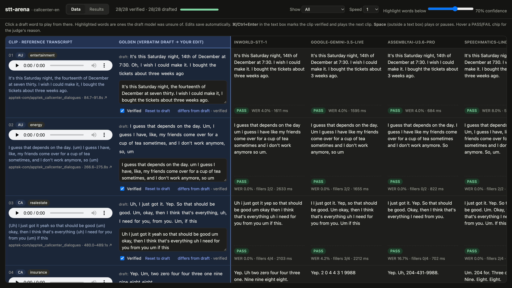

# stt-arena

A small eval harness for streaming speech-to-text. It plays your audio through a dozen STT models in real time, scores each one against human-verified transcripts, and has an LLM judge check whether the meaning survived.



Public leaderboards rank models by word error rate on audiobooks and earnings calls. Real users spell their surnames, read out account numbers and trail off mid-sentence, so the useful eval is one built on your own kind of audio and scored on meaning. The method follows Hamel Husain's [*Your AI Product Needs Evals*](https://hamel.dev/blog/posts/evals/): look at the data, use binary pass/fail, and check the judge against a human.

## Example results

The bundled dataset has 28 customer turns from role-played support calls across 14 English accents, full of spelled-out names, account numbers, dates and hesitation.

| Model | Judge pass | WER | Fillers kept | Latency p50 / p95 | Empty turns | $/min | Languages |
|---|---|---|---|---|---|---|---|
| `inworld/inworld-stt-1` | **89%** | 7.9% | 88% | 1767 / 2633 ms | 0 | 0.0017 | en only |
| `google/gemini-3.5-transcribe-live` | **89%** | 9.3% | 52% | 1661 / 2212 ms | 0 | 0.0095 | multi |
| `assemblyai/universal-3-6-pro` | **89%** | 10.2% | 29% | 628 / 865 ms | 0 | 0.0075 | multi |
| `speechmatics/linden-1` | **89%** | 11.0% | 77% | 649 / 821 ms | 0 | 0.0050 | multi |
| `deepgram/nova-2` | **82%** | 9.8% | 71% | 295 / 472 ms | 0 | 0.0047 | multi |
| `xai/stt-2` | **71%** | 10.5% | 0% | 913 / 1576 ms | 0 | 0.0033 | multi |
| `deepgram/nova-3` | **68%** | 10.5% | 7% | 296 / 354 ms | 0 | 0.0042 | multi |
| `openai/gpt-live-transcribe` | **68%** | 12.0% | 54% | 1091 / 1291 ms | 0 | 0.0170 | multi |
| `deepgram/flux-general-en` | **64%** | 11.3% | 43% | 1003 / 5258 ms | 0 | 0.0057 | en only |
| `cartesia/ink-whisper` | **64%** | 14.9% | 12% | 304 / 495 ms | 0 | 0.0023 | multi |
| `assemblyai/universal-streaming` | **64%** | 16.6% | 0% | 701 / 1550 ms | 1 | 0.0025 | en only |
| `cartesia/ink-2` | **61%** | 32.5% | 59% | 884 / 3854 ms | 7 | 0.0068 | en only |

<sub>One run, 28 clips, streamed through LiveKit Inference with prices from its Scale tier. Judge: Claude Haiku with `prompts/judge.md`. WER ignores fillers and formatting. A 1–2 clip difference is noise, not a ranking.</sub>

Half of all failures (41 of 84) were a wrong digit, a garbled name or a mangled spelling. Four models tie on meaning at 25 of 28 clips, so latency, price and languages decide between them. WER and the judge often disagree: `speechmatics/linden-1` has a worse WER than `deepgram/nova-3` and passes six more clips.

## How it works

1. **Golden transcripts.** ElevenLabs Scribe drafts a verbatim transcript, with fillers, false starts and stutters kept. You play each clip in the dashboard, fix the draft and press ⌘/Ctrl+Enter to mark it verified. Use a draft model you aren't evaluating, otherwise the golden inherits its mistakes.
2. **Streaming.** Each clip is played into each model at real-time speed in 20 ms frames, followed by 6 seconds of silence, the way a live voice agent would feed it. The runner keeps every final transcript with its timestamps and records latency (end of speech to the last final), empty turns, finals that only arrived when the stream closed, and revised finals.
3. **Judging.** An LLM judge reads the golden and each candidate and returns PASS or FAIL: would a support agent understand the customer the same way? A lost negation, a wrong digit or a wrong name fails. Fillers, punctuation and number formatting don't. Every FAIL quotes the two spans it compared.
4. **Scoring.** WER (normalised so formatting and fillers don't count), filler recall, latency and cost go into `results/_summary.json`. The dashboard shows every clip, its golden and every model's output side by side.

In the bundled dataset the goldens come from the source dataset's own manual verbatim transcripts. The Scribe draft is shown above each one for comparison.

### Why LiveKit Inference

Candidates are streamed through [LiveKit Inference](https://docs.livekit.io/agents/models/stt/), which puts all eight providers behind one API key and one streaming interface, so every model gets the same audio, framing, silence and clock.

The runner is the only part that knows about LiveKit. To call providers directly or test your own pipeline, write `results/<model>.json` yourself and the judge, scorer and dashboard work the same:

```json
{"clip_id": {"text": "final transcript", "latency_ms": 312, "finals": []}}
```

## Quick start

You need Python 3.11+, [uv](https://docs.astral.sh/uv/) and `ffmpeg`.

```bash
git clone https://github.com/HAizelf/stt-arena && cd stt-arena
uv sync
uv run python scripts/serve.py      # → http://127.0.0.1:8765
```

That opens the bundled example, results included. To run the whole thing yourself:

```bash
cp .env.example .env                    # LiveKit, ElevenLabs and Anthropic keys

uv run python scripts/draft_golden.py   # verbatim drafts
uv run python scripts/serve.py          # listen, fix, ⌘/Ctrl+Enter to verify
uv run python scripts/run_candidates.py # stream every clip through every model in models.json
uv run python scripts/judge.py run      # LLM judge (or `export` / `import` to use any judge)
uv run python scripts/score.py          # WER, filler recall, latency, summary
```

A full run of the example costs under a dollar: about 90 audio-minutes of LiveKit Inference, including the trailing silence, plus a few cents of judge calls.

Other tools:

- `run_candidates.py deepgram-nova-3 --clips 2` smoke-tests one model on two clips.
- `explain_model.py <model>` lists one model's FAILs and its most common substitutions.
- `debug_events.py <model> <clip>` prints every raw event a provider sends.

## Use your own audio

A dataset is a folder:

```
datasets/my-set/
  manifest.json      [{"id": "clip_01", "reference": "optional existing transcript", "accent": "...", "domain": "..."}]
  clips/clip_01.mp3
```

Point any script at it with `--dataset datasets/my-set`. Then:

1. Pick 30–50 clips that look like production, including the hard cases: noisy rooms, accents, numbers, people trailing off.
2. Draft the goldens and verify every one by ear.
3. Rewrite `prompts/judge.md` for your product. A support bot cares about account numbers, a health app about negations and symptoms, a meeting tool about names.
4. Edit `models.json` to choose candidates. Any [LiveKit Inference STT model](https://docs.livekit.io/agents/models/stt/) works, with provider options in `extra_kwargs`.

## Known gaps and gotchas

- **Trailing silence.** Too little makes good models look broken. With 3 seconds, Cartesia ink-2 (5.6 s end-of-turn timeout) came back empty on 9 of 28 clips. The default is 6 seconds (`--tail`). If a model looks absurdly bad, check the harness first.
- **Latency compares like with like.** Turn-aware models (Deepgram Flux, Cartesia ink-2, AssemblyAI u3, Inworld) send a final only once they decide the turn is over, so their number includes a turn-taking decision. Phrase-level models like Deepgram Nova finalise in about 300 ms, but your agent then adds its own turn detector.
- **Providers send finals differently.** Some re-send a turn, some send no timestamps. `scripts/assemble.py` detects revisions by text and keeps arrival order, and the "revised finals" column flags re-sent turns.
- **The judge is a model too.** It counts "Britney" for "Brittany" as a wrong name. Read the reasons, and if you disagree on more than a couple, tighten `prompts/judge.md` and re-run.
- **28 clips catch patterns, not decimals.** This size shows that a model drops every filler or mangles digits. It can't tell 89% from 86%.

## Repo layout

| Path | What it does |
|---|---|
| `scripts/prepare_apptek.py` | Builds the example dataset |
| `scripts/draft_golden.py` | Verbatim golden drafts (ElevenLabs Scribe) |
| `scripts/run_candidates.py` | Real-time streaming runner (LiveKit Inference) |
| `scripts/assemble.py` | Turns a provider's finals into one transcript |
| `scripts/judge.py` | LLM judge: `run`, or `export` / `import` for any other judge |
| `scripts/score.py` | WER, filler recall, latency and cost into `results/_summary.json` |
| `scripts/serve.py`, `web/index.html` | The dashboard |
| `models.json` | Candidate models and their options |
| `prompts/judge.md` | The judge's rubric |

## Credits and license

- The example audio and reference transcripts come from **[AppTek Call-Center Dialogues](https://huggingface.co/datasets/apptek-com/apptek_callcenter_dialogues)** (CC BY-SA 4.0): role-played calls, not real customers. Everything in `datasets/callcenter-en/` is shared under the same license; see [its README](datasets/callcenter-en/README.md).
- The method leans on Hamel Husain's [*Your AI Product Needs Evals*](https://hamel.dev/blog/posts/evals/).
- Code: MIT.
