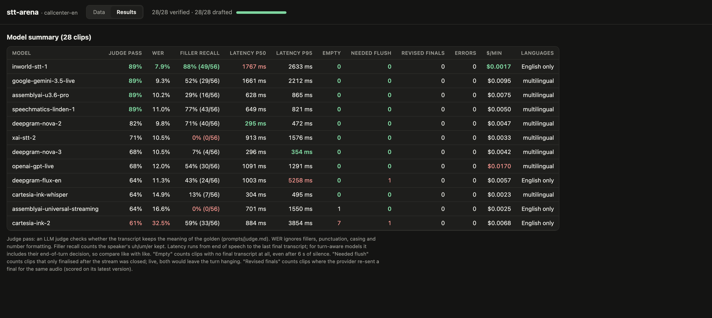

# stt-arena

**Find out which speech-to-text model actually understands *your* users, before they find out for you.**

Stream real audio through a dozen STT providers at once, score them against human-verified ground truth, and let an LLM judge ask the only question that matters: *did it get what the person meant?*


## Why I built this

Picking a speech-to-text provider usually goes like this: you open a leaderboard, sort by word error rate, take the cheapest model near the top, and ship it. Then a customer reads out their phone number and your agent hears *"Choose your four three one…"*.

That's a real transcript from this repo, from a model that sits comfortably in the middle of public leaderboards.

Leaderboards measure audiobooks, podcasts and earnings calls. Your users mumble, spell their surname letter by letter, read out order numbers, say "um" a lot, and trail off mid-sentence. **The only eval that tells you anything is one built on your own kind of audio**, scored on whether the *meaning* survived, not just how many words matched.

I couldn't find a small, honest tool that did that for streaming STT, so I built one. It's deliberately boring: a few dozen clips, ground truth a human has listened to, every provider streamed in real time the way a voice agent would use it, and a judge with a short rubric. It follows the approach in Hamel Husain's [*Your AI Product Needs Evals*](https://hamel.dev/blog/posts/evals/): look at your data, prefer binary pass/fail over vibes, and check the judge against a human.

## What I found

The example dataset in this repo has 28 customer turns from role-played support calls across **14 English accents**: US, AAVE, US Southern, UK, Scottish, Welsh, Irish, Indian, Australian, South African, Singaporean, Chinese, Mexican and Canadian. The clips are full of spelled-out names, account numbers, dates and hesitation.

| Model | Judge pass | WER | Fillers kept | Latency p50 / p95 | Empty turns | $/min | Languages |
|---|---|---|---|---|---|---|---|
| `inworld/inworld-stt-1` | **89%** | 7.9% | 88% | 1767 / 2633 ms | 0 | 0.0017 | en only |
| `google/gemini-3.5-transcribe-live` | **89%** | 9.3% | 52% | 1661 / 2212 ms | 0 | 0.0095 | multi |
| `assemblyai/universal-3-6-pro` | **89%** | 10.2% | 29% | 628 / 865 ms | 0 | 0.0075 | multi |
| `speechmatics/linden-1` | **89%** | 11.0% | 77% | 649 / 821 ms | 0 | 0.0050 | multi |
| `deepgram/nova-2` | **82%** | 9.8% | 71% | 295 / 472 ms | 0 | 0.0047 | multi |
| `xai/stt-2` | **71%** | 10.5% | 0% | 913 / 1576 ms | 0 | 0.0033 | multi |
| `deepgram/nova-3` | **68%** | 10.5% | 7% | 296 / 354 ms | 0 | 0.0042 | multi |
| `openai/gpt-live-transcribe` | **68%** | 12.0% | 54% | 1091 / 1291 ms | 0 | 0.0170 | multi |
| `deepgram/flux-general-en` | **64%** | 11.3% | 43% | 1003 / 5258 ms | 0 | 0.0057 | en only |
| `cartesia/ink-whisper` | **64%** | 14.9% | 12% | 304 / 495 ms | 0 | 0.0023 | multi |
| `assemblyai/universal-streaming` | **64%** | 16.6% | 0% | 701 / 1550 ms | 1 | 0.0025 | en only |
| `cartesia/ink-2` | **61%** | 32.5% | 59% | 884 / 3854 ms | 7 | 0.0068 | en only |

<sub>One run, 28 clips, streamed through LiveKit Inference in November 2026 with prices from its Scale tier. Judge: Claude Haiku with `prompts/judge.md`. WER ignores fillers and formatting. A 1–2 clip difference is noise, not a ranking.</sub>

A few things surprised me.

**Numbers and names are where models fail.** Half of all failures (41 of 84) were a wrong digit, a garbled name or a mangled spelling. "Z H A N G" became "C H A N G". "Two zero four four three one nine nine eight eight" came back as "204-431. 9922". If your agent takes account numbers, test account numbers.

**Four models tie, and they're nothing alike.** Inworld, Gemini, AssemblyAI's u3.6 pro and Speechmatics all kept the meaning on 25 of 28 clips. Inworld is the cheapest and keeps almost every "um", but it's English-only and finalises slowly. AssemblyAI and Speechmatics answer in about 650 ms and speak dozens of languages. Gemini costs 5× more than Inworld. The judge tells you who's *good enough*; latency, price and languages pick between them.

**Newer isn't automatically better.** Deepgram's nova-3 passed fewer clips than the older nova-2 (19 vs 23) and dropped almost every filler (7% vs 71%). It's still the fastest thing here. On your audio the answer might flip, which is the whole point of running it.

**Some models silently delete every "um".** xAI and AssemblyAI's universal-streaming kept 0 of 56 fillers. That's fine for a search box. It's not fine if you care *how* someone said something: hesitation is signal.

**Turn-aware models can go quiet.** Cartesia's ink-2 decides for itself when you've finished speaking. On 7 clips where the speaker trailed off ("…and I don't work anymore, so um"), it never committed the turn, even after 6 seconds of silence. Its interim transcripts were near-perfect; it just never said "done". Live, that turn would hang until the user spoke again.

**WER and meaning disagree.** Inworld has the best WER and Speechmatics one of the worst among the leaders, yet both pass the same 25 clips. One wrong "not" barely moves WER and changes everything; a dropped "okay" moves WER and changes nothing.



## How it works

### 1. Ground truth first, verified by a human

Everything downstream is only as good as the golden transcript, so this is the step I'd tell you not to skip.

A strong batch model, ElevenLabs Scribe, drafts a **verbatim** transcript: fillers, false starts and stutters included. You open the dashboard, play each clip, click any word to jump to it (low-confidence words are highlighted), fix what's wrong, and press ⌘/Ctrl+Enter to mark it verified. Thirty clips takes about twenty minutes.

Use a draft model you *aren't* evaluating. Otherwise the golden quietly inherits its mistakes, and it wins.

In the example dataset the goldens come from the source dataset's own manual verbatim transcripts. The Scribe draft sits above each one, and the two disagreed in exactly the places you'd expect: Scribe heard "Zhang Z" as "Chang C".

### 2. Stream every candidate, in real time

Each clip is played into each model at real-time speed in 20 ms frames, followed by 6 seconds of silence, exactly as a live voice agent would feed it. Batch accuracy doesn't predict streaming accuracy, so test the mode you'll ship.

From each stream I keep every final transcript with its timestamps, then measure:

- **latency:** end of speech to the last final transcript;
- **empty turns:** the model never finalised anything;
- **needed flush:** it only finalised once the stream was closed;
- **revised finals:** it re-sent text it had already finalised.

### 3. Judge the meaning, then count the words

The headline metric is a binary verdict from an LLM judge. Given the golden and a candidate, would a support agent understand the customer the same way? A lost negation, a wrong digit or a wrong name is a **FAIL**. Fillers, punctuation, "7:30" vs "seven thirty" and dropped backchannels are not. Every FAIL comes with a reason quoting the two spans, so you can check the judge's work.

WER and filler recall are still there as supporting numbers. WER is normalised so formatting doesn't count: digits, clock times and ordinals become words, and fillers are removed.

### 4. Look at the data

The dashboard puts every clip, its golden and every model's output side by side. Hover a PASS/FAIL chip to see why. Read twenty verdicts and note where you disagree with the judge. If you disagree a lot, the fix is a clearer `prompts/judge.md`, not more data.

## Why LiveKit Inference

Every candidate is streamed through [LiveKit Inference](https://docs.livekit.io/agents/models/stt/), which puts Deepgram, AssemblyAI, Cartesia, Speechmatics, Google, OpenAI, xAI and Inworld behind **one API key and one streaming interface**. That's the only reason it's here: it lets you test a dozen providers at the same time under identical conditions (same audio, same framing, same silence, same clock), without twelve SDKs and twelve accounts.

If you'd rather call providers directly, or test your own pipeline, the runner is the only part that knows about LiveKit. Write any process that produces `results/<model>.json`:

```json
{"clip_id": {"text": "final transcript", "latency_ms": 312, "finals": []}}
```

The judge, the scorer and the dashboard work the same either way.

## Quick start

You need Python 3.11+, [uv](https://docs.astral.sh/uv/) and `ffmpeg`.

```bash
git clone https://github.com/HAizelf/stt-arena && cd stt-arena
uv sync
uv run python scripts/serve.py      # → http://127.0.0.1:8765
```

That opens the bundled example, results included. To run the whole thing yourself:

```bash
cp .env.example .env                    # LiveKit, ElevenLabs and Anthropic keys

uv run python scripts/draft_golden.py   # verbatim drafts
uv run python scripts/serve.py          # listen, fix, ⌘/Ctrl+Enter to verify
uv run python scripts/run_candidates.py # stream every clip through every model in models.json
uv run python scripts/judge.py run      # LLM judge (or `export` / `import` to use any judge)
uv run python scripts/score.py          # WER, filler recall, latency, summary
```

Running the full example costs **well under a dollar**: about 90 audio-minutes of LiveKit Inference, including the trailing silence, plus a few cents of judge calls.

A few more tools:

- `run_candidates.py deepgram-nova-3 --clips 2` smoke-tests one model on two clips.
- `explain_model.py <model>` lists one model's FAILs and its most common substitutions.
- `debug_events.py <model> <clip>` prints every raw event a provider sends. Reach for it when a number looks wrong.

## Use your own audio

A dataset is a folder:

```
datasets/my-set/
  manifest.json      [{"id": "clip_01", "reference": "optional existing transcript", "accent": "...", "domain": "..."}]
  clips/clip_01.mp3
```

Point any script at it with `--dataset datasets/my-set`. Then:

1. **Pick 30–50 clips that look like production**, including the hard cases: noisy rooms, accents, numbers, people trailing off.
2. Draft the goldens and **verify every one by ear**.
3. Rewrite `prompts/judge.md` for your product. A support bot cares about account numbers; a health app cares about negations and symptoms; a meeting tool cares about names.
4. Edit `models.json` to choose candidates. Any [LiveKit Inference STT model](https://docs.livekit.io/agents/models/stt/) works, with provider options in `extra_kwargs`.

## Things that bit me

**Too little silence makes good models look broken.** My first run streamed 3 seconds of silence after each clip. Cartesia ink-2 came back empty on 9 of 28 clips: 38% WER, dead last. Its turn timeout is 5.6 seconds, so I was hanging up before it answered. With 6 seconds, only 2 of those 9 came back, so the 7 that never finalised are a real finding, not an artefact. If a model looks absurdly bad, check your harness before you blame the model.

**Latency only compares like with like.** Turn-aware models (Deepgram Flux, Cartesia ink-2, AssemblyAI u3, Inworld) send their final only once they've decided your *turn* is over, so their number includes a turn-taking decision. Phrase-level models like Deepgram Nova finalise each phrase in about 300 ms, but your voice agent then adds its own turn detector on top. If latency decides it for you, measure end of speech to agent reply.

**Providers send finals differently.** Some re-send a turn twice, formatted then unformatted. Some send continuations that all start at zero. Some send no timestamps. `scripts/assemble.py` detects revisions by text, not timestamps, and keeps arrival order, because that's what your agent actually sees. If a provider re-sends a turn, the "revised finals" column flags it: live, your agent may receive that text twice.

**The judge is a model too.** It made a few calls I'd argue with: "Brittany" vs "Britney" counts as a wrong name, which is right if the agent types it into a CRM and pedantic otherwise. Read the reasons. If you disagree on more than a couple, tighten the rubric and re-run.

**28 clips catch patterns, not decimals.** This size reliably shows that a model drops every filler or mangles digits. It can't tell 89% from 86%.

## Repo layout

| Path | What it does |
|---|---|
| `scripts/prepare_apptek.py` | Builds the example dataset |
| `scripts/draft_golden.py` | Verbatim golden drafts (ElevenLabs Scribe) |
| `scripts/run_candidates.py` | Real-time streaming runner (LiveKit Inference) |
| `scripts/assemble.py` | Turns a provider's finals into one transcript |
| `scripts/judge.py` | LLM judge: `run`, or `export` / `import` for any other judge |
| `scripts/score.py` | WER, filler recall, latency and cost into `results/_summary.json` |
| `scripts/serve.py`, `web/index.html` | The dashboard |
| `models.json` | Candidate models and their options |
| `prompts/judge.md` | The judge's rubric |

## Credits and license

- The example audio and reference transcripts come from **[AppTek Call-Center Dialogues](https://huggingface.co/datasets/apptek-com/apptek_callcenter_dialogues)** (CC BY-SA 4.0): role-played calls, not real customers. Everything in `datasets/callcenter-en/` is shared under the same license; see [its README](datasets/callcenter-en/README.md).
- The method leans on Hamel Husain's [*Your AI Product Needs Evals*](https://hamel.dev/blog/posts/evals/).
- Code: MIT.
